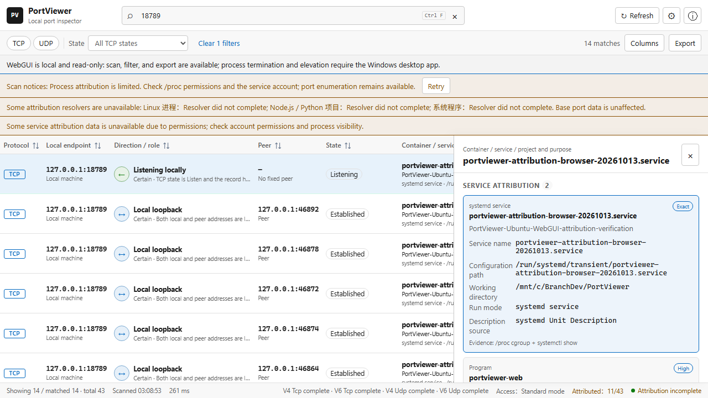

# Ubuntu 反馈修复与端口归属验证

验证日期：2026-10-13。Linux 实测环境为本机 WSL2 Ubuntu 24.04.4、Linux 6.6.87.2、x86_64、systemd 255；并非反馈中的 RTX 5090 主机。原始反馈文件保留不变。

## 反馈修复

| 反馈 | 本次处理 |
|---|---|
| 官方 systemd 配置下 health 正常、scan 500 | 地址族白名单补充 `AF_NETLINK`；扫描失败时提示检查该配置，并加入移除此地址族的对照回归 |
| `/portviewer/` 子路径白屏、API 404 | Vite 资源采用相对路径，API 相对 `document.baseURI` 解析；代理剥离前缀即可使用同一前端包 |
| 普通账号几乎没有进程归属 | 端口枚举与归属完整性分别报告；PID 0 显示未知归属；提供保留原有加固的显式 root drop-in，文档不再承诺单独 `CAP_SYS_PTRACE` 能解决所有权限问题 |
| 加固服务中项目名称与简介缺失 | 实际完整 systemd 沙箱会对 `openat2` 返回 `ENOSYS`；保留沙箱，增加只在该错误下启用的受限文件描述符路径解析 |

## 用户可见的归属信息

| 对象 | 名称、用途与路径 |
|---|---|
| Docker / docker-proxy | 容器名、镜像、OCI 简介、Compose 项目与服务、协议/地址/端口映射、Compose 目录和文件、容器工作目录、宿主挂载路径 |
| systemd | 进程 cgroup 对应的真实服务名、Description、unit 配置路径、工作目录；socket activation 仅匹配活跃且监听端点相符的单元 |
| Node/npm | 项目名称与 `package.json` 简介、真实 npm script、可识别框架运行方式、入口文件、工作目录、项目与配置路径 |
| Python | `pyproject.toml` 等元数据中的名称与简介、脚本或模块入口、可识别框架运行方式、虚拟环境和项目路径 |
| 系统程序 | 可执行文件路径、已知程序用途、可关联的服务；未知用途明确显示未确认 |

列表、详情、搜索、复制、CSV/JSON 和 CLI/MCP Markdown 均保留归属信息。新增 `container:`、`project:`、`mode:` 搜索字段。简介缺失时明确显示未提供，来源和置信度可以查看。

## 验证结果

| 检查 | 结果 |
|---|---|
| 前端 Vitest | 15 个文件、135 项测试通过 |
| 前端类型、Prettier、生产构建 | 通过 |
| Linux Rust | 49 项单元测试通过；Clippy `-D warnings` 通过 |
| Windows Web 后端兼容性 | 39 项单元测试通过 |
| Rust 格式 | 通过 |
| 真实 systemd/npm/Python 回归 | 通过，完整官方沙箱下验证 npm/Python 名称、简介、模式和路径；真实服务 Description/FragmentPath；普通账号未知归属与缺少 `AF_NETLINK` 的失败对照 |
| Linux LAN API/CLI/MCP 回归 | 最终验证包通过；容量查询 99.1ms |
| 根路径与子路径浏览器回归 | 实际 Linux WebGUI 的 5 项测试通过，包含 `/portviewer/` 和 query/hash 路径 |

关键反例包括：Docker published port 不覆盖同端口的已知宿主 Node 项目；UDP/TCP 和绑定地址匹配；远端 Docker context 被拒绝；停止的 socket unit 不参与匹配；容器与宿主同名目录不混淆；符号链接后的 `..` 按目标进程文件系统解析；真实 npm process title；Python 多行 TOML 简介；读取上限、命令截止时间和非普通文件拒绝；输出不包含环境变量、原始全量标签或完整命令行。

代码复审与安全复审均无剩余 P1/P2 阻塞。

以下截图来自最终验证包在真实 Linux 服务中的运行结果，子路径代理为 `/portviewer/`；选中的是本次测试自身的真实服务，显示其名称、Description、配置路径、工作目录与运行模式。



## 重跑命令

在原生 Ubuntu 仓库目录中，安装项目所需的 Node/Rust 环境后：

```bash
npm run build
npm test
npm run format:check
cargo fmt --manifest-path web-service/Cargo.toml --all -- --check
cargo test --manifest-path web-service/Cargo.toml
cargo clippy --manifest-path web-service/Cargo.toml --all-targets -- -D warnings
cargo build --manifest-path web-service/Cargo.toml
sudo node scripts/test-linux-deployment.mjs --integration
node scripts/test-lan-interfaces.mjs
npm run test:webgui-e2e
```

systemd 回归仅创建带 `portviewer-regression-` 前缀的临时单元与项目夹具，结束后停止自己的进程组并清理已知文件。无依赖安装或项目脚本探测。

## 验证边界

本机未安装 Docker Engine/CLI。Docker 解析、映射和安全边界已由夹具测试覆盖，本轮未用真实 Docker daemon 进行端到端验收。最终在反馈主机上确认容器归属仍需本地 Docker socket 访问权限。用途来自实际元数据；无法从端口或镜像名证明自定义业务的真实用途。

部署与权限选择见 [WebGUI 部署指南](webgui-deployment.md)。可执行验证包说明见仓库 `release/portviewer-linux-x64-attribution-preview/`。
